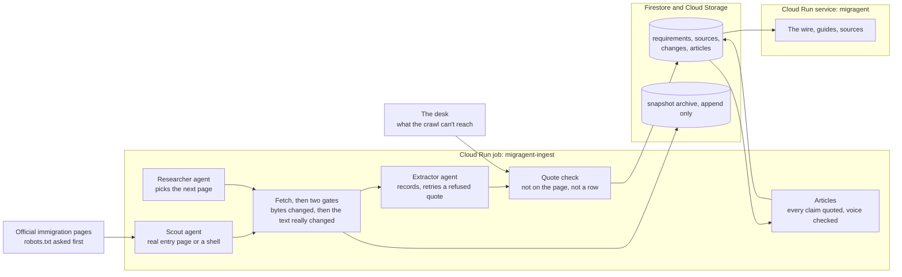

# MIGRAGENT

An AI reporter on the immigration beat. Every morning it reads the official immigration pages of
thirteen countries, works out what changed, and files it to the wire. Every claim in a story is a
sentence lifted word for word from the government's own page, and a claim it can't find on the page
gets cut before anyone reads it.

Live at https://migragent.onenept.com. How it's built: https://migragent.onenept.com/architecture.

## What you get

The wire. A UK eVisa that now takes up to 24 hours to show up. France raising the age limit for
South Korean working holiday visas to 35. New Zealand's employer work visa going from five and a
half weeks to five. Each story says who it's for and links the page it came from, and the report
under it says how many claims were found on the page and how many got dropped.

Guides, 104 of them, one per official page with real substance. Who it's for, what you have to
show, what it costs, and every line points back to the government's sentence.

Sources. Every page it reads, by country, with when it was last read and what it found. Study and
work are about getting in. Living is everything after: renewing, settling, family, healthcare, a
tax number, swapping a licence.

The Desk, for the people whose job is knowing the rules. Study-abroad agents and immigration
advisers get an alert the morning a rule moves in a country they sell.

## What it holds, on 15 October 2026

| | |
| --- | --- |
| Official pages on file | 1,355 |
| Countries | 15, of which 13 are read every morning |
| Requirements held, each with its quote | about 2,900 |
| Rule changes caught | 147 |
| Articles filed | 39 |
| Guides | 104 |

The live numbers are on `/sources`. The two countries on file but not read are the United States
and Australia, where robots.txt asks crawlers to stay out, so it does.

## The rules it holds itself to

Each one is enforced in code, and most were learned by getting it wrong first. `docs/DEFECTS.md`
has those written up as failures, not features.

Every claim carries a quote. A requirement stores a word-for-word span from its page, checked
against that page's text before the row is allowed to exist. A quote that's on the page but
stitched together from two real fragments gets refused too.

The robots gate isn't negotiable. A site that disallows us doesn't get read, and a site that won't
serve its robots.txt doesn't either. That's why Italy has no citizenship page: interno.gov.it
answers 403.

Nothing gets invented to fill a gap. If a page doesn't say what something costs, the story doesn't
either.

The house voice is checked in code, not just asked for in a prompt. `migragent/voice.py` fixes
dashes, rejects the usual AI vocabulary, and gets one rewrite for a headline before the story is
dropped. A dropped story is listed with the reason.

## How it's built

`docs/ARCHITECTURE.md` is the long version, and `/architecture` on the live site renders that same
file so the description and the build can't drift apart.

One Cloud Run service serves the wire. One Cloud Run job does the reading: thirty-nine tasks, one
per country and lane, thirteen countries, three lanes (study, work, living). Four Cloud Scheduler
jobs start it.

| Time (UTC) | What runs |
| --- | --- |
| 03:17 | retention sweep, deleting the last of the old cases as they expire |
| 04:40 | watch round: re-read every page, diff it, record what moved |
| 05:00 | job listings from government job boards |
| 05:40 | articles: write up each rule change for the wire |

Read first, then write. The other way round and it reports on yesterday.

Three ADK agents do the parts where the model has to decide what to do next. The Researcher picks
which page to open when the structural walk runs out of structure. The Scout tells a real entry
page from a page of links. The Extractor records requirements and goes back for a real sentence
when the quote check refuses one, instead of dropping it. Everything else that touches the model
is a single call with a code check on the answer. Decision 12 in `docs/DECISIONS.md` has where
that line is drawn and why.



Four identities, and the line between them is measured, not asserted. `migragent-web` serves
requests and can't start a crawl. `migragent-researcher` reads pages and calls the model, and
can't write anything down. `migragent-writer` writes. `migragent-watcher` is the only thing that
can read the snapshot archive back. `tools/test_isolation.py` is where that gets checked.

The desk (`/admin`) files what the crawl can't reach, through the same writer and the same quote
check, and a story that came that way says so in its report.

## $MIGRA

$MIGRA launched on Orbio's agent launchpad on Robinhood Chain. Its trading fees turn into AI credit
the agent can spend, and for its first days that credit paid for the morning reading and the first
articles. The reading runs on Vertex now. `/migra` has the live numbers, and holders vote on what
the agent covers next at `/migra/vote`.

## Running it yourself

You need Python 3.12 and a Google Cloud project with Firestore, Cloud Storage and Vertex AI turned
on. Everything below runs from the repository root.

```bash
pip install -r requirements.txt
playwright install chromium          # the container has no browser on purpose
gcloud auth application-default login
export GOOGLE_CLOUD_PROJECT=your-project-id
```

Create the four service accounts, then apply the permission model:

```bash
for sa in researcher writer watcher web; do
  gcloud iam service-accounts create migragent-$sa --project "$GOOGLE_CLOUD_PROJECT"
done
bash tools/grant_roles.sh            # every role in one readable file, with its reason
python tools/test_isolation.py       # then prove the roles are what the file says
```

Serve it:

```bash
python -m migragent.app              # http://localhost:8080
```

An empty project shows you an empty wire, so seed something and read it:

```bash
python -m tools.seed_registry                                 # the entry pages, per country and lane
python -m tools.run_round UK study --mode extract --limit 5   # fetch, extract, check every quote, store
```

`tools/grant_roles.sh` and most files under `tools/` carry this deployment's project id as a
constant near the top. The service reads `GOOGLE_CLOUD_PROJECT` from the environment and the tools
don't. Known rough edge, not a hidden one.

The batch side is one program with modes, run as a Cloud Run job in production and as a script
anywhere:

```bash
MIGRAGENT_MODE=watch    python -m migragent.worker   # re-read, diff, record what moved
MIGRAGENT_MODE=extract  python -m migragent.worker   # read pages nobody has read yet
MIGRAGENT_MODE=articles python -m migragent.worker   # write up each change for the wire
MIGRAGENT_MODE=listings python -m migragent.worker   # new jobs off government boards
MIGRAGENT_MODE=selftest python -m migragent.worker   # the watcher's own boundary
MIGRAGENT_MODE=robots   python -m migragent.worker   # print robots.txt as the job receives it
```

An unknown mode exits instead of falling through to the most expensive branch. That sentence is
here because of D38, where an old image met a new mode and started crawling a country.

`watch` only diffs pages it has read before, so it never reads a page for the first time. A new
lane or a newly seeded page needs one `extract` run, and after that the morning watch keeps it.

## The tests

Scripts, not a framework, and each one proves something the product says out loud. Most need
nothing but Python: no cloud project, no credentials, no network. Every model is scripted and every
client is trapped, so a test that tries to reach Vertex fails instead of quietly costing money.

```bash
python -m tools.test_occupations      # a quote that isn't on the page is refused
python -m tools.test_extractor_agent  # the Extractor retries a refused quote, never invents one
python -m tools.test_scout_agent      # the Scout keeps only pages that state a requirement
python -m tools.test_agent            # the ADK researcher never opens its own model client
python -m tools.test_lane_check       # a page's lane is read off the page, not inherited
python -m tools.test_articles         # a story only prints claims found on its page
python -m tools.test_voice            # the house voice holds, or the story is dropped
python -m tools.test_guides           # every guide line cites a requirement
python -m tools.test_governance       # votes are weighted by balance at close
python -m tools.test_tls              # pages with a broken TLS chain still get read
python tools/test_isolation.py        # the identity boundaries hold (needs a real project)
```

If you want to watch an agent work without spending anything, run
`python -m tools.test_extractor_agent`. It scripts a model that returns a true-sounding requirement
the page never states, and you can watch it get turned down and the agent go back for a real
sentence.

## Pre-existing code, and outside services

This repository started from a prior scaffold of the author's own. `migragent/identity.py` and
`migragent/config.py` came from it and were written on 17 August 2026. `docs/INHERITED.md` records
what came across and what was replaced. Everything else under `migragent/` and `tools/` was written
for this build.

Outside services: Google Cloud for nearly all of it (Vertex AI Gemini, Firestore, Cloud Run, Cloud
Storage, Cloud Scheduler), and Orbio for the $MIGRA launch and the AI credit it earns.

## History

Until 2 October 2026 MIGRAGENT also took people's own cases: uploads, a personal guide, alerts, a
CV builder. It was built for Google's All Things Agentic hackathon in August, and it was too agent
shaped for what people actually needed. That part was removed and the old URLs redirect. The
reading engine underneath it is the same one, and the code for the case product is still in the
repo where `docs/ARCHITECTURE.md` says it no longer runs.

## Where it's incomplete, said plainly

Spain's social security site serves us a 403 from the US region the job runs in, so those pages
don't get read.

Some lanes are thin. Sweden's living lane has a handful of pages, and Saudi Arabia and Ireland
hold very few requirements.

The United States and Australia are on file and never read, because their robots.txt says no.

`docs/DEFECTS.md` and `docs/DECISIONS.md` carry the rest, including the embarrassing ones.
